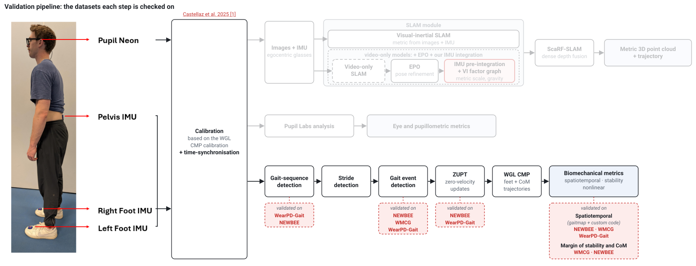
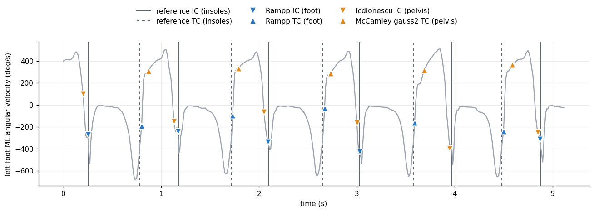

  <h1>Biomechanical Validation for Neon-IMU-Analysis</h1>
  

    Vignesh Radhakrishnan, Mark Hollands 
    School of Sport &amp; Exercise Sciences, Liverpool John Moores University, UK
  

  

  

Validation results so far: the biomechanical branch of the [Neon-IMU-Pipeline](https://github.com/vigneshrk29/Neon-IMU-Pipeline), from a lower-back (pelvis) IMU and two foot IMUs, compared with insoles, optical motion capture and a pressure walkway on three public datasets. The original pipeline (base) is compared with the modified pipeline.

The results page is on the [website](https://vigneshrk29.github.io/Biomechanical-Verification/). It shows the pipeline, the datasets, the reference data and metrics, and the results for gait-sequence detection, gait events, zero-velocity updates (ZUPT), ground contact and gait metrics (spatiotemporal parameters and margin of stability), per walking type.

  

## Data

- [NEWBEE](https://www.nature.com/articles/s41597-022-01580-3) (Losing &amp; Hasenjäger, Scientific Data 2022): Xsens full-body suit and pressure insoles, outdoor walking with curbs, ramps and stairs.
- [WMCG](https://www.nature.com/articles/s41597-026-07657-7) (Hossain et al., Scientific Data 2026): IMUs and optical motion capture, level and stair walking.
- [WearGait-PD](https://www.nature.com/articles/s41597-026-06806-2) (Anderson et al., Scientific Data 2026): IMUs, pressure insoles and a pressure walkway, people with Parkinson's disease and age-matched controls.
